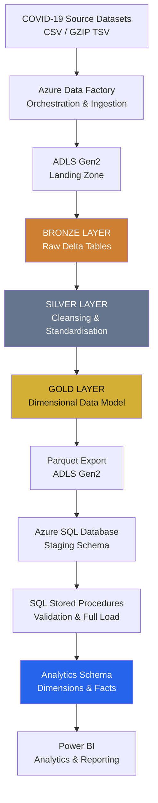

# ⚡ AI-Augmented Azure Data Engineering Platform

### End-to-End Cloud Data Engineering | Medallion Architecture | Dimensional Modelling | Analytics

An end-to-end Azure Data Engineering platform that ingests, transforms, validates and models European COVID-19 datasets using modern cloud data technologies.

Built using **Azure Data Factory, Azure Data Lake Storage Gen2, Azure Databricks, Unity Catalog, PySpark, Delta Lake, Azure SQL Database and Power BI**, this project demonstrates a scalable, modular and governed batch data engineering architecture.

AI-assisted development practices using GitHub Copilot were incorporated to improve code organisation, SQL development and engineering productivity.

**INGEST → TRANSFORM → MODEL → VALIDATE → ANALYSE**

---

## ◈ Project at a Glance

| Category | Details |
|---|---|
| Domain | Public Health Analytics |
| Architecture | Medallion Architecture |
| Processing | Batch Data Processing |
| Orchestration | Azure Data Factory |
| Data Lake | Azure Data Lake Storage Gen2 |
| Processing Engine | Azure Databricks / PySpark |
| Storage Format | Delta Lake / Parquet |
| Governance | Unity Catalog |
| Data Warehouse | Azure SQL Database |
| Visualisation | Power BI |
| Source Control | GitHub |
| AI-Assisted Development | GitHub Copilot |

## ◈ Project Highlights

- End-to-end cloud data engineering pipeline.
- Automated ingestion and orchestration using Azure Data Factory.
- Medallion architecture implementation using ADLS Gen2 and Delta Lake.
- Modular PySpark transformation pipelines.
- Unity Catalog-based data governance and access management.
- Dimensional modelling with 3 dimensions and 4 fact tables.
- SQL-based analytical warehouse with staging, analytics and audit schemas.
- Data quality checks, referential integrity and record-count reconciliation.
- AI-assisted SQL development and Python code refactoring.

## ◈ Solution Architecture

The platform follows a structured data processing workflow, from source ingestion to analytical reporting.



## ◈ Technology Stack

| Technology | Implementation |
|---|---|
| Azure Data Factory | Pipeline orchestration, Copy activities and Mapping Data Flows |
| ADLS Gen2 | Centralised cloud storage |
| Azure Databricks | Distributed data transformation |
| Apache Spark | Large-scale data processing |
| PySpark | Modular transformation logic |
| Delta Lake | Bronze, Silver and Gold table storage |
| Unity Catalog | Data governance and access management |
| Azure SQL Database | Staging and analytical warehouse |
| T-SQL | DDL, stored procedures and data validation |
| Power BI | Analytical reporting |
| GitHub | Version control and documentation |
| GitHub Copilot | AI-assisted code development and refactoring |

---

## ◈ Medallion Architecture

The solution follows a three-layer Medallion Architecture to separate ingestion, transformation and analytical modelling.

### 🟤 Bronze — Raw Data Ingestion

**Objective:** Preserve source data and establish ingestion traceability.

Key implementations:

- Ingests CSV and compressed TSV datasets.
- Stores ingested data as Delta tables.
- Captures ingestion timestamps.
- Maintains source-file metadata.
- Performs source-to-target record-count reconciliation.
- Uses reusable Python ingestion functions.

Implementation: `src/bronze/ingestion.py`

### ⚪ Silver — Cleansing & Standardisation

**Objective:** Convert raw datasets into consistent, analytics-ready data.

Four modular PySpark transformation pipelines:

| Module | Key Responsibilities |
|---|---|
| `cases_deaths.py` | Country standardisation, date conversion, indicator and geography validation |
| `hospital.py` | Daily and weekly indicator processing and duplicate validation |
| `population.py` | Wide-to-long transformation, age-group processing and population quality checks |
| `country_lookup.py` | Country reference standardisation and additional geographical records |

Implementation: `src/silver/`

### 🟡 Gold — Dimensional Modelling

**Objective:** Build analytical datasets for downstream reporting.

The Gold layer implements a **Fact Constellation (Galaxy) Schema** consisting of three dimension tables and four fact tables.

#### Dimension Tables

| Table | Description | Records |
|---|---|---:|
| `dim_country` | Country reference dimension | 211 |
| `dim_date` | Date dimension | 298 |
| `dim_age_group` | Age-group dimension | 6 |
| **Total** | | **515** |

#### Fact Tables

| Table | Description | Records |
|---|---|---:|
| `fact_covid_daily` | Daily COVID cases and deaths | 64,635 |
| `fact_hospital_daily` | Daily hospital metrics | 8,110 |
| `fact_hospital_weekly` | Weekly hospital metrics | 867 |
| `fact_population_age` | Population distribution by age | 3,816 |
| **Total** | | **77,428** |

#### Gold Dimensional Model

The model uses shared dimensions to maintain consistent analytical relationships across multiple fact tables.

**Relationship overview:**

| Fact Table | Related Dimensions | Business Grain |
|---|---|---|
| `fact_covid_daily` | Country, Date | Geography + Date |
| `fact_hospital_daily` | Country, Date | Country + Date + Indicator |
| `fact_hospital_weekly` | Country | Country + Year-Week + Indicator |
| `fact_population_age` | Country, Age Group | Geography + Age Group + Year |

**Schema classification:** Fact Constellation (Galaxy Schema).

The country dimension is shared across all four fact tables. The date dimension is shared by the daily COVID and hospital fact tables. The age-group dimension supports population demographic analysis.

Regional and special-geography records may legitimately contain null country keys where no country-level dimension mapping exists.

**Model diagram:**

Add the generated diagram to your repository under `architecture/images/`, then embed it here:

``

Implementation: `src/gold/`

---

## ◈ Azure SQL Database – Analytical Warehouse

The Gold datasets are exported as Parquet files and loaded into Azure SQL staging tables.

The SQL warehouse separates database objects into three schemas:

| Schema | Responsibility |
|---|---|
| `staging` | Incoming analytical datasets |
| `analytics` | Final dimension and fact tables |
| `audit` | Pipeline execution, load-control and failure information |

### SQL Engineering Highlights

- Reusable stored procedures for full-load operations.
- Dimension loading before fact loading.
- Duplicate and foreign-key validation.
- Transaction management.
- `TRY...CATCH` exception handling.
- `XACT_ABORT` transaction protection.
- `THROW` for error propagation.
- Pipeline execution and failure auditing.
- Service-principal permission scripts.

**Loading strategy:** Full refresh.

Incremental loading and Change Data Capture (CDC) are outside the current project scope.

---

## ◈ Data Quality & Validation

Data quality checks are incorporated throughout the processing workflow to ensure consistency, completeness and referential integrity.

| Layer | Validation Approach |
|---|---|
| Bronze | Dataset validation and source-to-target count reconciliation |
| Silver | Null checks, duplicate detection, indicator validation and geography checks |
| Gold | Schema validation, expected counts, fact-grain checks and foreign-key audits |
| Azure SQL | Duplicate checks, referential integrity and loading validation |

### Validated Project Results

| Metric | Result |
|---|---:|
| Dimension Tables | 3 |
| Fact Tables | 4 |
| Total Gold Records | 77,943 |
| Country Dimension Records | 211 |
| Date Dimension Records | 298 |
| Age Group Dimension Records | 6 |
| COVID Daily Records | 64,635 |
| Hospital Daily Records | 8,110 |
| Hospital Weekly Records | 867 |
| Population-Age Records | 3,816 |
| Population Age Groups | 6 |
| Population Geographies | 53 |
| Population Years | 12 |

**Additional Validation Findings**

- 62,878 country-level COVID records.
- 1,757 regional COVID aggregate records with intentional null country keys.
- 22 null measures in the weekly hospital fact.
- 264 null population percentages.
- 432 null country keys in the population fact.
- No negative or above-100 population percentages.
- No null age-group keys.
- All seven Parquet exports reconciled against their Gold record counts.

**Note:** These validation results are from the original Azure project execution. The refactored GitHub code has not yet been independently redeployed and executed against Azure.

---

## ◈ Security & Governance

The platform adopts identity-based access and governed data management practices.

Security implementations include:

- Azure Databricks Access Connector with managed identity for storage authentication.
- Unity Catalog storage credentials and external locations.
- Governed access through Unity Catalog volumes.
- Separate Bronze, Silver and Gold schemas.
- Azure SQL service-principal permissions.
- Least-privilege access principles.
- Centralised Python logging utilities.
- No hardcoded credentials in application code.

These practices support controlled access to cloud storage and governed data management.

---

## ◈ Repository Structure

```text
azure-covid-data-platform/
│
├── architecture/
│
├── docs/
│   ├── 01_architecture.md
│   ├── 02_data_pipeline.md
│   ├── 03_bronze_layer.md
│   ├── 04_silver_layer.md
│   ├── 05_gold_layer.md
│   ├── 06_azure_sql_warehouse.md
│   ├── 07_data_quality_and_auditing.md
│   ├── 08_security_and_access.md
│   ├── 09_deployment_guide.md
│   └── 10_validation_results.md
│
├── powerbi/
│
├── sql/
│   ├── 01_schema_setup/
│   ├── 02_staging_tables/
│   ├── 03_analytics_tables/
│   ├── 04_audit/
│   ├── 05_stored_procedures_load/
│   ├── 06_stored_procedure_log/
│   └── 07_validation/
│
├── src/
│   ├── bronze/
│   │   └── ingestion.py
│   │
│   ├── silver/
│   │   ├── cases_deaths.py
│   │   ├── hospital.py
│   │   ├── population.py
│   │   └── country_lookup.py
│   │
│   ├── gold/
│   │   ├── dim_country.py
│   │   ├── dim_date.py
│   │   ├── dim_age_group.py
│   │   ├── fact_covid_daily.py
│   │   ├── fact_hospital_daily.py
│   │   ├── fact_hospital_weekly.py
│   │   └── fact_population_age.py
│   │
│   └── common/
│       ├── config.py
│       ├── data_quality.py
│       ├── logging_utils.py
│       └── spark_utils.py
│
├── .gitignore
└── README.md
```

---

## ◈ Engineering Practices

This project emphasises maintainability and production-oriented engineering practices:

- Modular Python architecture.
- Explicit SparkSession dependency injection.
- Reusable PySpark transformation functions.
- Centralised configuration and logging.
- Schema and data-quality validation.
- Separation of business transformations and audit logic.
- Unity Catalog-based data governance.
- SQL transaction management and error handling.
- Git-based source control and documentation.
- AI-assisted development and SQL refactoring using GitHub Copilot.

---

## ◈ Documentation

Explore the detailed technical documentation:

| Document | Description |
|---|---|
| [01 — Architecture](docs/01_architecture.md) | Solution architecture and technology stack |
| [02 — Data Pipeline](docs/02_data_pipeline.md) | End-to-end pipeline execution |
| [03 — Bronze Layer](docs/03_bronze_layer.md) | Data ingestion and metadata |
| [04 — Silver Layer](docs/04_silver_layer.md) | PySpark transformations |
| [05 — Gold Layer](docs/05_gold_layer.md) | Dimensional modelling |
| [06 — Azure SQL Warehouse](docs/06_azure_sql_warehouse.md) | Staging and analytical warehouse |
| [07 — Data Quality & Auditing](docs/07_data_quality_and_auditing.md) | Validation framework |
| [08 — Security & Access](docs/08_security_and_access.md) | Identity and governance |
| [09 — Deployment Guide](docs/09_deployment_guide.md) | Environment setup and deployment |
| [10 — Validation Results](docs/10_validation_results.md) | Project validation metrics |

---

## ◈ Project Scope & Future Enhancements

The current implementation focuses on static datasets and full-refresh batch processing.

Potential future enhancements include:

- Incremental ingestion and Change Data Capture.
- Automated deployment using Azure DevOps or GitHub Actions.
- Centralised monitoring using Azure Monitor and Log Analytics.
- Automated data-quality gates and pipeline alerts.
- Environment-specific infrastructure deployment using Terraform or Bicep.
- Automated unit and integration testing.

---

## ◈ About This Project

This project demonstrates an end-to-end Azure Data Engineering workflow, bringing together cloud ingestion, distributed processing, data modelling, relational warehousing, governance and reporting.

The GitHub repository contains the modular refactored Python code, SQL scripts and technical documentation.

The original Azure implementation and Power BI model were validated. The refactored GitHub implementation remains subject to a fresh Azure execution and deployment
