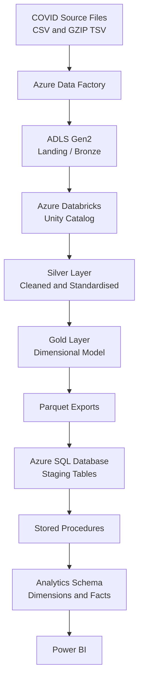

# Azure COVID Data Engineering Platform — Architecture

## 1. Project Overview

The Azure COVID Data Engineering Platform is an end-to-end batch data engineering solution designed to ingest, transform, validate and load European COVID-19 datasets into an analytical data warehouse.

The platform uses Azure Data Factory for orchestration and data movement, Azure Data Lake Storage Gen2 for data storage, Azure Databricks with PySpark for data transformation, Unity Catalog for data governance, and Azure SQL Database for analytical reporting.

The final dimensional model supports downstream reporting and analysis through Power BI.

## 2. Architecture Diagram

## 3. Technology Stack

| Technology | Purpose |
|---|---|
| Azure Data Factory | Pipeline orchestration and data ingestion |
| Azure Data Lake Storage Gen2 | Centralised data lake storage |
| Azure Databricks | Distributed data processing |
| Apache Spark / PySpark | Data transformation and processing |
| Unity Catalog | Data governance and access management |
| Azure SQL Database | Relational analytical warehouse |
| SQL Server / T-SQL | Table creation, stored procedures and validation |
| Power BI | Reporting and visualisation |
| GitHub | Source code management and version control |

## 4. Data Processing Architecture

The platform follows the Medallion Architecture, separating data processing into three logical layers.

### Bronze Layer — Raw Data Ingestion

- Receives source datasets from Azure Data Factory.
- Stores ingested data in Delta tables.
- Preserves source information for downstream processing.
- Adds ingestion metadata such as ingestion timestamp and source file.
- Supports controlled batch ingestion.

### Silver Layer — Data Cleansing and Standardisation

- Standardises country names, codes and geographical attributes.
- Converts source data into appropriate data types.
- Transforms population data from wide format into long format.
- Separates daily and weekly hospital indicators.
- Performs data quality checks and duplicate detection.
- Publishes cleaned datasets as Silver Delta tables.

### Gold Layer — Analytical Data Modelling

The Gold layer creates a dimensional model consisting of:

**Dimension tables**
- `dim_country`
- `dim_date`
- `dim_age_group`

**Fact tables**
- `fact_covid_daily`
- `fact_hospital_daily`
- `fact_hospital_weekly`
- `fact_population_age`

The fact tables use dimension keys where applicable and are designed to support analytical reporting.

## 5. Azure SQL Data Warehouse Integration

The Gold datasets are exported as Parquet files and loaded into Azure SQL Database staging tables.

SQL stored procedures perform the full-load process from staging into the analytical `analytics` schema.

The loading process includes:
- Data validation.
- Duplicate checks.
- Foreign-key validation.
- Dimension loading before fact loading.
- Transaction handling.
- Audit and failure logging.

## 6. Reporting Layer

Power BI connects to the analytical warehouse to provide reporting across COVID cases, hospital admissions and population demographics.

The dimensional model supports analysis across geographical areas, dates and age groups.

## 7. Processing Approach

This project implements batch processing using static European COVID datasets. It is not a real-time streaming architecture and does not implement change data capture.

The Azure SQL loading strategy uses a full-refresh approach rather than incremental loading.

## 8. Architecture Design Considerations

- Separation of ingestion, transformation and analytical modelling.
- Reusable Python modules for maintainability.
- Unity Catalog-based data access and governance.
- Centralised logging utilities.
- Data quality checks across processing layers.
- SQL-based validation and audit mechanisms.
- Version-controlled source code and SQL scripts.
