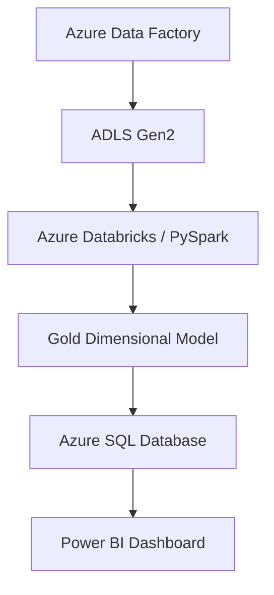

# 📊 COVID-19 Analytics Dashboard — Power BI

### Business Intelligence | Healthcare Analytics | Population Demographics

An interactive Power BI reporting solution built on the Azure COVID Data Engineering Platform.

The dashboard transforms curated analytical datasets into meaningful visual insights, enabling exploration of COVID-19 trends, hospital metrics and population demographics across geographical regions.

---

## ◈ Dashboard Overview

The report contains three analytical pages:

### 1. Global Overview

**Objective:** Provide a consolidated view of COVID-19 trends and geographical distribution.

This page focuses on the overall COVID-19 analytical dataset, supporting exploration of cases and deaths across geographical areas and reporting dates.

### 2. Hospital & Healthcare Analytics

**Objective:** Analyse hospital admission patterns and healthcare indicators.

This page uses daily and weekly hospital datasets to support analysis of healthcare trends over time and across geographical areas.

### 3. Population Demographics

**Objective:** Explore population distribution across age groups, geographies and years.

This page uses the population-age analytical dataset to support demographic comparisons and population percentage analysis.

---

## ◈ Technology Stack

| Technology | Purpose |
|---|---|
| Power BI Desktop | Report development and visualisation |
| Azure SQL Database | Analytical reporting data source |
| SQL | Dimensional data retrieval |
| Power Query | Data connectivity and preparation |
| DAX | Measures and analytical calculations |
| Star Schema | Analytical data modelling |

---

## ◈ Data Architecture

The Power BI report is the presentation layer of the end-to-end Azure Data Engineering Platform.

Power BI consumes the analytical dimension and fact tables from the Azure SQL `analytics` schema.

### Analytical Tables

**Dimensions**
- `dim_country`
- `dim_date`
- `dim_age_group`

**Facts**
- `fact_covid_daily`
- `fact_hospital_daily`
- `fact_hospital_weekly`
- `fact_population_age`

---

## ◈ Dashboard Pages

| Report Page | Analytical Focus |
|---|---|
| Global Overview | COVID cases, deaths and geographical trends |
| Hospital & Healthcare Analytics | Daily and weekly hospital metrics |
| Population Demographics | Population distribution by age group and geography |

---

## ◈ How to Access the Dashboard

1. Download `covid_analytics_dashboard.pbix` from this repository.
2. Open the file using Microsoft Power BI Desktop.
3. Configure or refresh the Azure SQL data connection if required.
4. Authenticate using an authorised database identity.
5. Explore the three report pages.

**Note:** Access to the original Azure SQL database may require valid credentials and network permissions. The PBIX file does not guarantee that an external user can access the original database.

---

## ◈ Project Integration

This dashboard completes the reporting layer of the Azure COVID Data Engineering Platform.

The end-to-end workflow:

**Azure Data Factory → ADLS Gen2 → Databricks → PySpark → Gold Dimensional Model → Azure SQL → Power BI**

The analytical model provides a consistent reporting foundation across COVID statistics, healthcare indicators and population demographics.

---

## ◈ Project File

| File | Description |
|---|---|
| `covid_analytics_dashboard.pbix` | Power BI interactive report |

### Screenshots

Dashboard screenshots will be added here as report-page previews become available.

---

## ◈ Engineering Scope

The Power BI report is part of a broader data engineering solution demonstrating:

- Cloud-based data ingestion.
- Medallion architecture.
- PySpark transformations.
- Dimensional data modelling.
- Azure SQL warehouse integration.
- Data quality and validation.
- Business intelligence reporting.

